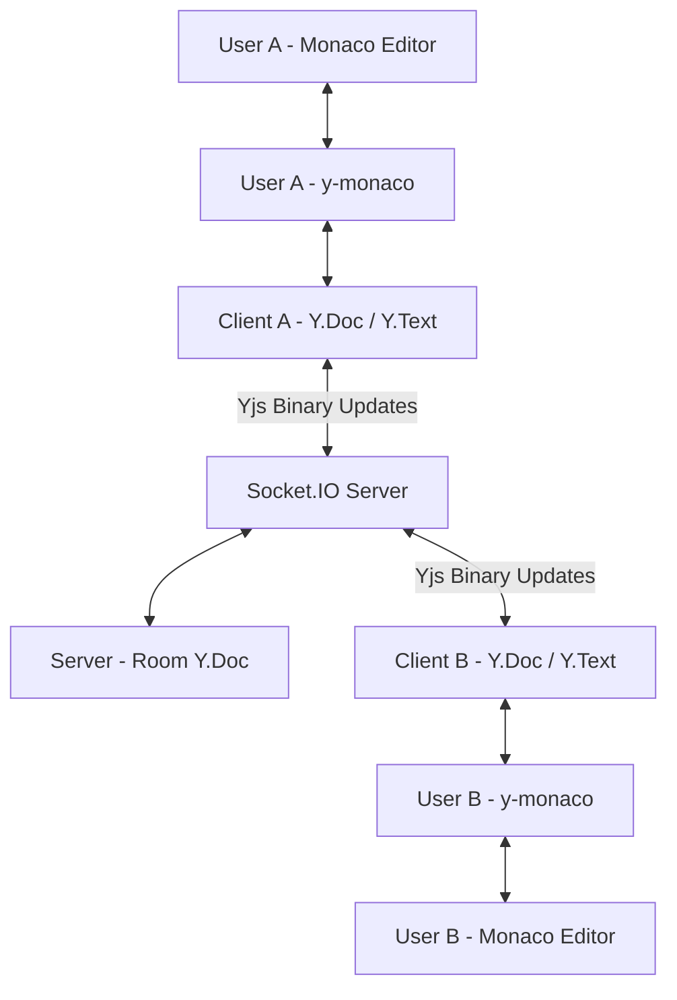

# 🚀 SyncForge

### Real-Time Collaborative Code Editor Powered by Yjs CRDTs and Socket.IO

SyncForge is a real-time collaborative code editor that enables multiple developers to write, edit, and collaborate on the same code document simultaneously within shared coding rooms.

Built using **React.js, Node.js, Express.js, Monaco Editor, Socket.IO, and Yjs**, SyncForge uses **Conflict-Free Replicated Data Types (CRDTs)** to support concurrent editing without overwriting other users' changes.

The project focuses on real-time communication, concurrent state synchronization, room-based collaboration, and connection recovery.

**GitHub Repository:** [SyncForge](https://github.com/kavyagrwl25/SyncForge)

---

## ✨ Features

### 👥 Real-Time Collaborative Editing

- Multiple users can edit the same code document simultaneously.
- Yjs CRDTs support convergence of concurrent edits.
- Incremental binary synchronization instead of full-document transmission.
- Independent collaborative rooms identified by room IDs.
- Room-scoped communication using Socket.IO.
- Automatic synchronization for newly joining users.

### 🧠 Code Editor

- Monaco Editor, the editor technology used in VS Code.
- Syntax highlighting for JavaScript, Python, C++, and Java.
- Real-time remote cursor visualization.
- Programming language synchronization across room participants.
- Responsive editor interface.

### 🔄 Connection and State Management

- Automatic Socket.IO reconnection.
- Bidirectional synchronization using Yjs state vectors.
- Recovery of missing updates after temporary disconnections.
- Browser refresh recovery while the server retains the room document.
- Active user tracking and connection status monitoring.
- Room join and activity notifications.

### ⚙️ Backend and Room Management

- Event-driven communication using Socket.IO.
- One server-side `Y.Doc` per active room.
- Room membership validation before processing collaborative updates.
- Isolated document state for different rooms.
- Cleanup of expired room documents.
- Automated integration tests covering collaborative synchronization.

---

## 🛠️ Tech Stack

| Layer | Technology |
|-------|------------|
| Frontend | React.js, Vite, Tailwind CSS |
| Code Editor | Monaco Editor |
| Collaboration Engine | Yjs (CRDT) |
| Monaco Integration | y-monaco |
| Real-Time Communication | Socket.IO |
| Backend | Node.js, Express.js |
| Document State | In-memory Y.Doc per active room |
| Testing | Node.js, Socket.IO and Yjs integration tests |

---

## 🏗️ System Architecture

SyncForge follows an event-driven client-server architecture in which each client maintains an independent Yjs document, while the server maintains a synchronized document for each active room.



### Core Components

**Monaco Editor**

Provides the code editing interface, syntax highlighting, and cursor management.

**Yjs**

Manages collaborative documents using CRDTs, allowing concurrent changes to converge consistently across clients.

**y-monaco**

Connects Monaco's text model with Yjs `Y.Text`, keeping editor content synchronized with the local collaborative document.

**Socket.IO**

Transports Yjs updates and handles room-based real-time communication.

**Server-side Y.Doc**

Maintains the synchronized document state for each active collaborative room and supports initial synchronization and reconnection.

---

## ⚡ How SyncForge Works

### 1. Real-Time Collaborative Editing

When a user modifies code, Yjs generates an incremental update that is transmitted through Socket.IO.

```text
User A edits code
       |
       v
Monaco Editor
       |
       v
y-monaco updates Y.Text
       |
       v
Client Y.Doc generates update
       |
       v
Socket.IO sends binary update
       |
       v
Server applies update to room Y.Doc
       |
       v
Server broadcasts update to room participants
       |
       v
User B applies update to local Y.Doc
       |
       v
y-monaco updates Monaco
       |
       v
User B sees the changes
```

Unlike full-document synchronization, this approach integrates document changes instead of replacing the entire code string.

Yjs manages CRDT convergence, while Socket.IO is responsible for transporting updates.

### 2. Concurrent Editing with CRDTs

Traditional full-document synchronization can cause lost updates when multiple users edit simultaneously.

For example:

- User A inserts text at one position.
- User B inserts text at another position.
- Both generate Yjs updates independently.
- The server receives and broadcasts the updates.
- Every Yjs replica integrates the received changes.

Because Yjs uses CRDTs, replicas receiving the same updates eventually converge to the same document state, regardless of update arrival order.

The application integrates the Yjs library rather than implementing a CRDT algorithm from scratch.

### 3. Initial Document Synchronization

When a new user joins an existing room:

```text
New user joins room
       |
       v
Client sends join request
       |
       v
Server identifies room Y.Doc
       |
       v
Exchange Yjs state vectors
       |
       v
Determine missing document updates
       |
       v
Exchange and apply missing updates
       |
       v
Client Y.Text becomes synchronized
       |
       v
Monaco displays shared code
```

A **Yjs state vector** represents which document updates a replica already knows.

This allows the client and server to exchange missing changes instead of blindly replacing the document state.

### 4. Disconnection and Reconnection

SyncForge supports state reconciliation after temporary network interruptions.

```text
User disconnects
       |
       v
Local Y.Doc retains edits
       |
       v
Other users continue editing
       |
       v
User reconnects
       |
       v
Client rejoins room
       |
       v
Client and server exchange state vectors
       |
       v
Missing Yjs updates are synchronized
       |
       v
Documents converge
```

This supports temporary offline editing while the browser page remains open and retains its Yjs document.

Offline edits are not guaranteed to survive closing or refreshing the browser while disconnected.

### 5. Server-Side Room Management

Each active collaborative room has its own Yjs document.

```text
Server
  |
  |-- Room ABC123
  |      |
  |      └── Y.Doc
  |
  |-- Room XYZ456
  |      |
  |      └── Y.Doc
  |
  └── Room DEF789
         |
         └── Y.Doc
```

The server:

- Creates a Yjs document when required.
- Maintains independent state for each room.
- Applies valid client updates.
- Broadcasts updates to other participants.
- Provides document state to joining and reconnecting users.
- Removes documents after room expiration.

Room membership is validated before incoming updates are applied.

### 6. Room Cleanup

When the last participant leaves a room:

1. The server starts a short cleanup timer.
2. If a user rejoins before expiration, cleanup is canceled.
3. If the room remains empty, the server destroys its Yjs document.
4. The document is removed from server memory.

This reduces unnecessary memory usage from abandoned rooms.

### 7. Live Cursor Synchronization

Remote cursor positions are communicated through separate Socket.IO events.

```text
User moves cursor
       |
       v
cursor-position-change
       |
       v
Socket.IO Server
       |
       v
Broadcast to room
       |
       v
Remote clients
       |
       v
Monaco decorations
       |
       v
Remote cursor displayed
```

Monaco decorations are used to visualize other participants' cursor positions.

The current cursor implementation uses absolute line and column positions, which may drift during concurrent edits that shift document content.

---

## 📁 Project Structure

```text
SyncForge/
|
├── client/
|   └── src/
|       ├── collaboration/
|       |   └── roomSync.js
|       |
|       ├── components/
|       |   ├── CodeEditor.jsx
|       |   ├── ActiveUsers.jsx
|       |   ├── Header.jsx
|       |   └── Notifications.jsx
|       |
|       ├── pages/
|       |   └── EditorPage.jsx
|       |
|       └── socket.js
|
├── server/
|   ├── socket/
|   |   ├── socketHandler.js
|   |   |
|   |   └── roomManager/
|   |       └── roomYDoc.js
|   |
|   └── test/
|       └── yjs-sync.test.js
|
└── README.md
```

### Important Files

| File | Responsibility |
|------|----------------|
| `EditorPage.jsx` | Client document lifecycle and room UI |
| `CodeEditor.jsx` | Monaco Editor and Yjs binding |
| `roomSync.js` | Client-side updates, initialization, and reconnection |
| `socketHandler.js` | Server-side events, validation, and broadcasting |
| `roomYDoc.js` | Server-side Yjs document management |
| `yjs-sync.test.js` | Collaborative synchronization integration tests |

---

## 🚀 Getting Started

### Prerequisites

- Node.js
- npm
- Git

### 1. Clone the Repository

```bash
git clone https://github.com/kavyagrwl25/SyncForge.git
cd SyncForge
```

### 2. Install Backend Dependencies

```bash
cd server
npm install
```

### 3. Start the Backend

```bash
npm run dev
```

### 4. Install Frontend Dependencies

Open another terminal from the project root:

```bash
cd client
npm install
```

### 5. Start the Frontend

```bash
npm run dev
```

Open the local URL displayed by Vite, typically:

```text
http://localhost:5173
```

Make sure the frontend's Socket.IO server URL and backend CORS configuration match your local environment.

### 6. Start Collaborating

1. Open SyncForge.
2. Create or join a collaborative room.
3. Share the room ID with another user.
4. Join the same room from another browser window.
5. Edit code collaboratively in real time.

---

## 🧪 Testing

The Yjs migration includes automated integration tests using actual Socket.IO connections and Yjs documents.

### Run Backend Integration Tests

```bash
cd server
npm test
```

### Build the Frontend

```bash
cd client
npm run build
```

---

## 🧠 Engineering Decisions

### Why Yjs instead of Full-Document Synchronization?

The earlier implementation transmitted the entire code string whenever a user edited the document.

This approach could overwrite concurrent edits.

Yjs enables incremental CRDT synchronization and deterministic convergence of concurrent changes.

### Why Socket.IO?

Socket.IO provides event-driven, bidirectional communication with room-based broadcasting and reconnection support.

It acts as the transport layer for Yjs updates.

### Why Maintain a Y.Doc on the Server?

The server maintains an up-to-date document replica for each active room.

This helps newly joining users obtain existing document state and allows disconnected clients to reconcile missing changes when they reconnect.

### Why Use y-monaco?

Monaco provides the editor, while Yjs manages collaborative text.

`y-monaco` connects Monaco's text model with `Y.Text`, synchronizing changes in both directions.

### Why Use State Vectors?

State vectors help identify changes missing from a Yjs replica.

They enable efficient synchronization during room joining and reconnection without replacing the entire document.

---

## ⚠️ Current Limitations

### In-Memory Document Storage

SyncForge currently uses a single-server, in-memory document store.

There is no durable database persistence for collaborative documents.

If the server loses its state and no client retains a document replica, collaborative code may be lost.

### Offline Browser Refresh

Local edits can be retained during temporary disconnections while the page remains open.

Recovering unsent changes after refreshing or closing the browser while offline is not currently supported.

### Remote Cursor Awareness

Remote cursors use line and column positions rather than CRDT-relative positions.

Cursor decorations may become inaccurate when concurrent edits shift text positions.

### Scope

SyncForge is a collaborative code editor, not a complete cloud IDE.

Integrated code execution, multi-file workspaces, and deployment environments are outside its current scope.

---

## 🔮 Future Improvements

Potential enhancements include:

- Temporary document persistence using Redis with an expiration policy.
- CRDT-aware cursor and selection tracking.
- Automated browser end-to-end testing.
- Improved monitoring and error handling.
- Multi-server synchronization when scaling requirements justify it.
- Optional code execution using secure sandboxing.

These are future possibilities, not features of the current implementation.

---

## 🤝 Contributing

Contributions, bug reports, and suggestions are welcome.

If you are modifying collaborative synchronization behavior, please include tests covering concurrency, document consistency, and room isolation.

---

## 👩‍💻 Author

**Kavya Agrawal**

- [GitHub](https://github.com/kavyagrwl25)
- [LinkedIn](https://www.linkedin.com/in/kavya-agrawal-a097402a1/)

---

**SyncForge — Collaborative coding powered by CRDT-based synchronization.**
